<!-- ───────────────────────── HERO ───────────────────────── -->
<p align="center">
  
</p>

<p align="center">
  <a href="https://git.io/typing-svg">
    
  </a>
</p>

<p align="center">
  <a href="https://portfolio-ten-delta-yzdhqw2gff.vercel.app/"></a>
  <!-- <a href="https://www.linkedin.com/in/YOUR-HANDLE/"></a> -->
  <a href="https://github.com/TANJIRO1709?tab=repositories"></a>
  
</p>



## ⚡ `cat about.json`

```json
{
  "name": "Sujal Kumar Agarwal",
  "based_in": "Rourkela, Odisha 🇮🇳",
  "education": "B.Tech, Electronics & Instrumentation @ NIT Rourkela (2023 – present)",
  "experience": "Project Intern @ Fractal Analytics — CogentIQ AI (May – Jul 2026)",
  "leading": "Vice-President @ Webwiz, NIT Rourkela's official web dev club (100+ members)",
  "focus": ["Backend engineering", "GenAI & agentic AI", "Systems built from scratch"],
  "motto": "WORK FOR UNIQUENESS"
}
```


## 🛰️ Featured Projects

<table>
  <tr>
    <td width="50%">
      <a href="https://github.com/TANJIRO1709/Tachyon"></a>
    </td>
    <td width="50%">
      <a href="https://github.com/TANJIRO1709/Strata"></a>
    </td>
  </tr>
  <tr>
    <td width="50%">
      <a href="https://github.com/TANJIRO1709/RefactorIQ"></a>
    </td>
    <td width="50%">
      <a href="https://github.com/TANJIRO1709?tab=repositories&q=TerraAgent"></a>
    </td>
  </tr>
</table>

<details>
<summary><b>🔍 Project deep-dive (click to expand)</b></summary>
<br>

- **Tachyon (AI Inference System)**: a real-time LLM inference serving layer in Node.js/TypeScript with dynamic request batching (size- and latency-bounded windows). It raised throughput 10× and held p99 latency under 50 ms at 64 req/s.
- **Strata**: my own Redis engine, built from scratch.
- **RefactorIQ**: a full-stack AI-powered code review platform built with Next.js and Node.js/Express. It has a VS Code-style editor, GitHub OAuth and a real-time review dashboard over SSE streaming, and supports 5+ core workflows.
- **TerraAgent**: an AI infrastructure agent that turns plain-English prompts into live AWS provisioning. Gemini plans the resources, then the agent makes real AWS SDK v3 calls instead of simulating them.
- **Container_Service**: Amazon ML Challenge work.

</details>


## 💼 Experience

<details open>
<summary><b>Fractal Analytics — Project Intern</b> · <i>May 2026 – July 2026</i></summary>
<br>

- Worked on **CogentIQ AI**, contributing to agentic AI platforms used across **15+ internal workflows**, with hands-on experience in production-grade AI systems.
- Built and optimized **FastAPI** backend services, cutting API response latency by **20%** across **63+ endpoints** through efficient request handling and performance tuning.
- Developed LLM-driven pipelines processing **10,000+ requests/day** with a modular architecture, cutting **33%** of redundant compute/API calls.

</details>

<details>
<summary><b>Webwiz, NIT Rourkela — Vice-President</b></summary>
<br>

- Leading NIT Rourkela's official web development club of **100+ active members**.

</details>

<details>
<summary><b>Apstronics — Freelance Software Developer</b> · <i>Oct 2025 – Dec 2025</i></summary>
<br>

- Freelance software development.

</details>


## 🧰 Tech Arsenal

<p align="center">
  
</p>
<p align="center">
  
  
  
  
</p>


## 🧊 Contributions in 3D

<p align="center">
  
</p>

<p align="center">
  
  
</p>

<p align="center">
  
</p>

<p align="center">
  <picture>
    <source media="(prefers-color-scheme: dark)" srcset="https://raw.githubusercontent.com/TANJIRO1709/TANJIRO1709/output/github-snake-dark.svg" />
    <source media="(prefers-color-scheme: light)" srcset="https://raw.githubusercontent.com/TANJIRO1709/TANJIRO1709/output/github-snake.svg" />
    
  </picture>
</p>


<p align="center">
  
</p>
